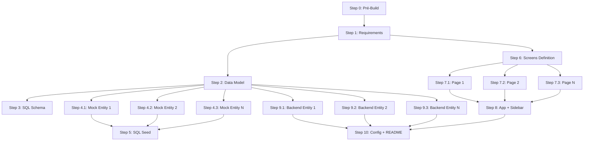

# /build-parallel — Pipeline Paralelo com DAG

Execute o pipeline de geração do projeto com paralelização inteligente de etapas independentes.

Incluir nó de assistente local conforme `skill-pricing-assistant.md`, dependente de roadmap/requirements/data_model/business_logic/screens/workflows e scenario_dependencies quando houver. Executar antes da integração final do shell, com dono frontend único. Default habilitado, sem API de IA ou comando extra. Não gerar catálogo antes das regras/fontes estarem disponíveis; atualizar incrementalmente quando hashes mudarem.

## Vantagens sobre /build

- **3x mais rápido**: Paraleliza entidades, páginas e componentes independentes
- **Uso eficiente de recursos**: Aproveita batch API da Anthropic
- **Mesma qualidade**: Mantém todas as validações e checkpoints do /build

## Argumento opcional

`$ARGUMENTS` — etapa inicial (ex.: `step4` para retomar a partir de mock_data). Se vazio, começa do início.

---

## DAG de Dependências



---

## Etapas Sequenciais vs Paralelas

### Sequenciais (Bloqueantes)
- **Step 0**: Pré-Build (validação inicial)
- **Step 1**: Requirements Extraction
- **Step 2**: Data Model Generation
- **Step 3**: SQL Schema Generation
- **Step 5**: SQL Seed (aguarda todos os mocks)
- **Step 6**: Screens Definition
- **Step 8**: App Principal (aguarda todas as páginas)
- **Step 10**: Config + README (aguarda backend e frontend)

### Paralelas (Independentes)

#### Step 4: Mock Data Generation
```yaml
parallel_group: mock_data
dependencies: [step2]
workers:
  - entity: clientes
    output: [mock_data/clientes.csv, mock_data/clientes.json]
  - entity: produtos
    output: [mock_data/produtos.csv, mock_data/produtos.json]
  - entity: pedidos
    output: [mock_data/pedidos.csv, mock_data/pedidos.json]
    depends_on: [clientes]  # FK para clientes
```

**Ordem de execução:**
1. Calcular topological sort das entidades (respeitar FKs)
2. Agrupar em níveis de dependência
3. Executar cada nível em paralelo

**Exemplo:**
```
Nível 0 (sem FKs): [usuarios, categorias, status]
Nível 1 (FK para nível 0): [clientes, produtos]
Nível 2 (FK para nível 1): [pedidos, avaliacoes]
```

#### Step 7: Frontend Pages
```yaml
parallel_group: frontend_pages
dependencies: [step6]
workers:
  - page: dashboard
    output: [frontend/pages/dashboard/*.py]
  - page: clientes
    output: [frontend/pages/clientes/*.py]
  - page: produtos
    output: [frontend/pages/produtos/*.py]
```

**Todas as páginas são independentes** — podem ser geradas simultaneamente.

#### Step 9: Backend Entities
```yaml
parallel_group: backend_entities
dependencies: [step2]
workers:
  - entity: clientes
    output: [backend/models/clientes.py, backend/schemas/clientes.py, ...]
  - entity: produtos
    output: [backend/models/produtos.py, backend/schemas/produtos.py, ...]
```

**Entidades sem FKs circulares** podem ser geradas em paralelo.

---

## Protocolo de Execução Paralela

### 1. Análise de Dependências

Antes de iniciar qualquer grupo paralelo:

```python
<thinking>
# Analisar data_model.yaml
entities = ["usuarios", "clientes", "produtos", "pedidos"]

# Construir grafo de dependências
graph = {
    "usuarios": [],
    "clientes": ["usuarios"],  # FK para usuarios
    "produtos": [],
    "pedidos": ["clientes", "produtos"]  # FK para ambos
}

# Topological sort
levels = [
    ["usuarios", "produtos"],      # Nível 0
    ["clientes"],                  # Nível 1
    ["pedidos"]                    # Nível 2
]

# Executar cada nível em paralelo
</thinking>
```

### 2. Execução em Batch

Para cada nível de dependência:

```markdown
## Executando Nível 0 (2 entidades em paralelo)

Batch 1:
- /skill04-mock-data usuarios
- /skill04-mock-data produtos

Aguardar conclusão de ambas...

✓ mock_data/usuarios.csv
✓ mock_data/usuarios.json
✓ mock_data/produtos.csv
✓ mock_data/produtos.json

Validação:
- /skill00-validator step4 --entity usuarios
- /skill00-validator step4 --entity produtos

Checkpoint: step4_level0.json
```

### 3. Sincronização

Após cada nível paralelo:

1. **Aguardar** todas as tasks do nível completarem
2. **Validar** cada artefato gerado
3. **Criar checkpoint** do nível
4. **Avançar** para próximo nível ou próxima etapa

---

## Estimativa de Ganho de Performance

### Projeto Exemplo: 10 entidades, 8 páginas

#### Build Sequencial (/build)
```
Step 1: Requirements        →  2 min
Step 2: Data Model          →  3 min
Step 3: SQL                 →  4 min
Step 4: Mock (10 entities)  → 20 min  (2 min cada)
Step 5: Seed                →  3 min
Step 6: Screens             →  2 min
Step 7: Pages (8 pages)     → 24 min  (3 min cada)
Step 8: App                 →  2 min
Step 9: Backend (10 ent.)   → 30 min  (3 min cada)
Step 10: Config             →  1 min
────────────────────────────────────
TOTAL:                        91 min
```

#### Build Paralelo (/build-parallel)
```
Step 1: Requirements        →  2 min
Step 2: Data Model          →  3 min
Step 3: SQL                 →  4 min
Step 4: Mock (3 níveis)     →  6 min  (2+2+2, paralelo)
Step 5: Seed                →  3 min
Step 6: Screens             →  2 min
Step 7: Pages (paralelo)    →  3 min  (todas ao mesmo tempo)
Step 8: App                 →  2 min
Step 9: Backend (paralelo)  →  3 min  (todas ao mesmo tempo)
Step 10: Config             →  1 min
────────────────────────────────────
TOTAL:                        29 min
```

**Ganho: 3.1x mais rápido** (91 → 29 minutos)

---

## Tratamento de Erros em Paralelo

### Falha em Worker Individual

Se um worker falhar (ex.: mock_data/produtos.csv):

1. **Continuar** outros workers do mesmo nível
2. **Marcar** worker como failed
3. **Ao final do nível**, reportar falhas
4. **Permitir retry** apenas do worker que falhou

```
❌ FALHA no Nível 0 — Worker: produtos

Workers bem-sucedidos (2):
  ✓ usuarios
  ✓ categorias

Workers com falha (1):
  ✗ produtos
    Erro: FK inválida para 'categoria_id'
    Sugestão: Verificar se 'categorias' foi gerado corretamente

Ações disponíveis:
  1. /build-parallel --retry step4 --entity produtos
  2. /build-parallel --skip produtos --continue
  3. /build-parallel --abort
```

### Falha em Validação

Se validação falhar após nível paralelo:

1. **Identificar** qual worker causou o problema
2. **Rollback** apenas desse worker
3. **Manter** workers bem-sucedidos
4. **Permitir correção** e retry

---

## Modo de Uso

### Build Completo Paralelo
```
/build-parallel
```

### Retomar de Etapa Específica
```
/build-parallel step7
```

### Retry de Worker Específico
```
/build-parallel --retry step4 --entity pedidos
```

### Forçar Sequencial (Fallback)
```
/build-parallel --sequential
```

---

## Configuração de Paralelização

Criar `.build/parallel.config.yaml` para customizar:

```yaml
parallelization:
  enabled: true
  max_workers: 5  # máximo de workers simultâneos
  
  step4_mock_data:
    enabled: true
    batch_size: 3  # processar 3 entidades por vez
    
  step7_frontend:
    enabled: true
    batch_size: 4  # processar 4 páginas por vez
    
  step9_backend:
    enabled: true
    batch_size: 5
    
  fallback_to_sequential:
    on_error: true
    on_timeout: true
```

---

## Integração com Extended Thinking

Antes de cada grupo paralelo:

```markdown
<thinking>
## Análise de Paralelização — Step 4 (Mock Data)

Entidades totais: 10
Grafo de dependências:
  - usuarios: []
  - categorias: []
  - produtos: [categorias]
  - clientes: [usuarios]
  - pedidos: [clientes, produtos]
  - avaliacoes: [produtos, clientes]
  - pagamentos: [pedidos]
  - entregas: [pedidos]
  - logs: [usuarios]
  - notificacoes: [usuarios]

Níveis de dependência:
  Nível 0 (4 entidades): usuarios, categorias, logs, notificacoes
  Nível 1 (3 entidades): produtos, clientes
  Nível 2 (2 entidades): pedidos, avaliacoes
  Nível 3 (2 entidades): pagamentos, entregas

Estimativa de tempo:
  - Sequencial: 10 × 2min = 20min
  - Paralelo: 4 níveis × 2min = 8min
  - Ganho: 2.5x

Estratégia: Executar em 4 batches paralelos
</thinking>
```

---

## Checkpoints em Modo Paralelo

Estrutura de checkpoint por nível:

```json
// .build/checkpoints/step4_level0.json
{
  "step": 4,
  "level": 0,
  "timestamp": "2024-06-03T15:30:00Z",
  "workers": [
    {
      "entity": "usuarios",
      "status": "success",
      "files": {
        "mock_data/usuarios.csv": "hash123...",
        "mock_data/usuarios.json": "hash456..."
      },
      "duration_seconds": 2.3
    },
    {
      "entity": "categorias",
      "status": "success",
      "files": {
        "mock_data/categorias.csv": "hash789...",
        "mock_data/categorias.json": "hashabc..."
      },
      "duration_seconds": 1.8
    }
  ],
  "validation": "passed",
  "total_duration_seconds": 2.5
}
```

---

## Limitações

1. **Não paraleliza** etapas com dependências fortes (1, 2, 3, 5, 6, 8, 10)
2. **Requer análise** de dependências antes de cada grupo paralelo
3. **Pode consumir mais recursos** (memória, API calls)
4. **Fallback automático** para modo sequencial em caso de problemas

---

## Próximos Passos

Após implementar `/build-parallel`:

1. Adicionar métricas de performance em `.build/metrics.json`
2. Criar dashboard de progresso em tempo real
3. Implementar retry inteligente com backoff exponencial
4. Adicionar suporte a distributed workers (futuro)
